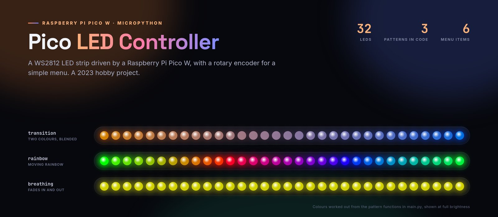

# Pico LED Controller

**LED patterns and a rotary-encoder menu on a Raspberry Pi Pico W.**



MicroPython code for a Raspberry Pi Pico W driving a strip of 32 WS2812 ("NeoPixel") LEDs, with an EC11 rotary encoder for a small menu. A 2023 hobby project, still a work in progress.

- **Three patterns in the code:** `transition` (two opposite colours blended along the strip, slowly shifting), `rainbow` (a moving rainbow) and `breathing` (the whole strip fades in and out in yellow).
- **Encoder menu** with 6 items. Press to open it, turn to move, press to pick. It closes after 5 seconds with no input.
- **Serial printout.** The menu and the current pattern are printed to the serial console (REPL); there is no screen.
- **Everything it needs is here:** `main.py` plus the rotary encoder library files.

## Status: known issues

- **Only the first pattern shows.** The 10-second auto-change check sits after the endless main loop, so it never runs.
- **Brightness is fixed** at 7 out of 255 (dim). The menu shows it but can't change it yet, and the potentiometer on GP28 is set up but never read.
- The **"Advance pattern"** and **pattern on/off** menu items only print; they don't change anything yet.
- After you pick an item once, the menu keeps reopening (select mode is never cleared), so the strip only updates every few seconds.

## Hardware

- Raspberry Pi Pico W (the code doesn't use Wi-Fi)
- WS2812 LED strip, 32 LEDs (`NUM_LEDS` in `main.py`)
- EC11 rotary encoder with push button
- Potentiometer (wired in the code, not used yet)

### Wiring (from the code)

| Pico pin | Goes to |
|---|---|
| GP16 | LED strip data in |
| GP0 | Encoder A (CLK) |
| GP1 | Encoder B (DT) |
| GP2 | Encoder button, other side to GND (internal pull-up) |
| GP28 (ADC2) | Potentiometer wiper (not read yet) |
| GND | Strip GND, encoder common, potentiometer |

The code doesn't turn on pull-ups for GP0 and GP1, so use an encoder board that has its own pull-up resistors, or add them.

## How to run

1. Install MicroPython for the Pico W.
2. Copy `main.py`, `rotary.py` and `rotary_irq_rp2.py` to the Pico, for example with Thonny or:

   ```sh
   mpremote cp main.py rotary.py rotary_irq_rp2.py :
   ```

3. Reset the Pico. `main.py` runs at start-up. Open the REPL (Thonny's shell) to see the messages.

`machine`, `neopixel`, `time`, `math` and `urandom` are built into MicroPython; nothing else needs installing. `rotary_irq_pico.py` is another version of the encoder driver and isn't used.

### The menu

1. **Press** the encoder: the menu opens.
2. **Turn** to move through: Toggle Automode, Adjust brightness, Advance pattern, Toggle animation 1 on/off, Toggle animation 2, Toggle animation 3.
3. **Press** to pick the item. On Toggle Automode, turning now switches it on or off.
4. **Press** again to leave, or wait 5 seconds.

## Files

| File | What it is |
|---|---|
| `main.py` | The LED controller |
| `rotary.py`, `rotary_irq_rp2.py` | Rotary encoder library from Mike Teachman's [micropython-rotary](https://github.com/MikeTeachman/micropython-rotary) (MIT) |
| `rotary_irq_pico.py` | Another version of the encoder driver, not used |

## Code overview

The code consists of several parts:

1. **Importing necessary libraries** - Various libraries are imported that provide necessary functionalities such as controlling the GPIOs, manipulating time, handling mathematical operations etc.

2. **Definition of Constants and Global Variables** - The script defines several constants and global variables used throughout the code. Constants include the number of LEDs in the strip, maximum brightness, frames per second, and the input pins. The global variables keep track of the current state of the program such as current pattern, brightness level, encoder position, etc.

3. **Interrupts and Handlers** - An interrupt is set on the encoder button, and its corresponding handler `button_press()` handles the transitions between different menu modes.

4. **Menu Management Functions** - Functions such as `update_menu_values()`, `poll_encoder()`, and `enter_menu()` are used to update menu values, poll the encoder for its current value, and manage the menu system respectively.

5. **LED Animation Functions** - Functions such as `rainbow()`, `breathing()`, and `transition()` define different LED strip animations.

6. **Helper Functions** - Various helper functions are used to handle the color scales, color transitions and switching between patterns.

7. **Main Program Loop Control** - The `loop()` function is where the main program logic lies. It continually executes the currently selected LED pattern and updates the LEDs accordingly.
